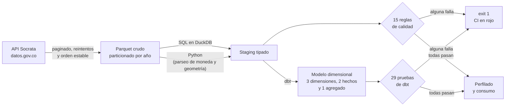
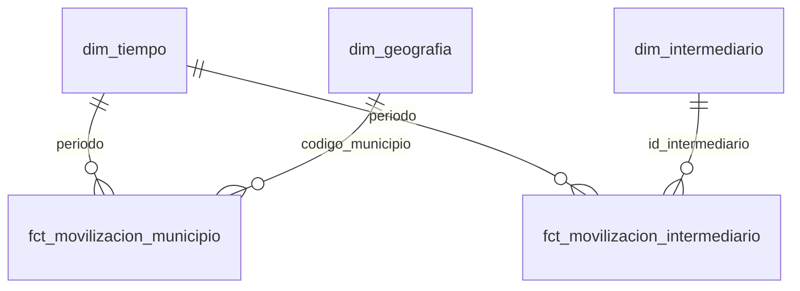
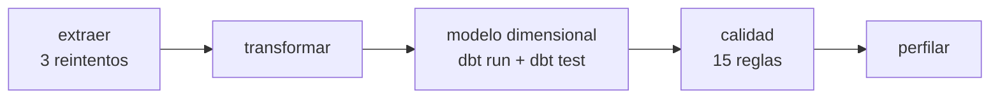

# Pipeline ELT de movilización financiera en Colombia

[](https://github.com/Alejandro1431/pipeline-movilizacion-financiera/actions/workflows/pipeline.yml)
[](LICENSE)

Descargo datos abiertos de la Superintendencia Financiera de Colombia y de
Findeter, los dejo en Parquet particionado, los tipé en DuckDB y construyo encima
un modelo dimensional con dbt. Cada carga pasa por reglas de calidad que cortan el
proceso cuando algo no cuadra.

En números: 194.832 filas de 3 fuentes, 15 reglas de calidad, 50 pruebas de Python
y 29 de dbt, y unos 40 segundos de ejecución completa (21 en carga incremental).

## Qué responde

| Pregunta | Resultado sobre los datos cargados |
|---|---|
| ¿Cuánto se movilizó por departamento en el último año completo? | Bogotá 6.445 mil millones, Antioquia 3.787, Valle 1.928 |
| ¿Qué tipo de intermediario mueve más operaciones? | Bancos: 32 entidades y 7.688.832 desembolsos |
| ¿Cómo evolucionó la movilización mes a mes? | 213 periodos, de enero de 2009 a septiembre de 2026 |
| ¿A qué sectores se dirigió el crédito de redescuento? | Energía 3.427, Vivienda 2.857, Transporte 2.838 millones de millones |

Todo esto sale de `python -m pipeline perfil`, que calcula las cifras sobre el
warehouse. Ninguna está escrita a mano.

## Arquitectura



El crudo no se toca nunca. Si una transformación está mal, corrijo el SQL y
reconstruyo el staging sin volver a llamar a la API.

## Fuentes

| Fuente | Entidad | Dataset | Filas | Cobertura |
|---|---|---|---|---|
| `movilizacion_municipio` | Superintendencia Financiera | `xcga-ji4i` | 179.500 | 2009-01 a 2026-09 |
| `movilizacion_intermediario` | Superintendencia Financiera | `xbk8-edux` | 12.350 | 2009-01 a 2026-09 |
| `desembolsos_redescuento` | Findeter | `bu9y-ytgi` | 2.982 | 2021 a 2024 |

Las tres se publican en [datos.gov.co](https://www.datos.gov.co) y se consumen por
la API Socrata, sin credenciales.

El staging de municipios termina en 179.462 filas y no en 179.500: el origen
publica 38 claves repetidas y se agregan con `SUM`. Está contado más abajo.

## Stack

- **Python 3.12** para la extracción y para la limpieza que SQL no expresa bien.
- **DuckDB** como motor analítico y warehouse. Un archivo, sin servidor.
- **Parquet** para el crudo, particionado por año, en disco o en un bucket S3.
- **S3** como almacenamiento de objetos opcional, con `httpfs` de DuckDB y boto3.
  El CI lo verifica contra un servidor S3 simulado en cada push.
- **dbt** para el modelo dimensional: linaje, documentación y pruebas declarativas.
- **Prefect** para orquestar: dependencias, reintentos e historial de ejecuciones.
- **pytest** para las funciones de limpieza, el cliente de la API y el flujo.
- **GitHub Actions** corriendo el pipeline en disco y contra un bucket en cada push.

## Cómo ejecutarlo

En Windows hay un atajo que crea el entorno, instala y corre todo:

```powershell
.\run.ps1              # pipeline completo
.\run.ps1 test         # solo las pruebas
.\run.ps1 quality      # solo las reglas de calidad
```

Paso a paso, en cualquier sistema:

```bash
python -m venv .venv
.venv\Scripts\activate          # en Linux/macOS: source .venv/bin/activate
pip install -r requirements.txt

export PYTHONPATH=src           # en PowerShell: $env:PYTHONPATH = "src"
python -m pipeline all          # extract + transform + marts + quality
python -m pipeline all --incremental   # lo mismo, trayendo solo lo nuevo
python -m pipeline flujo        # el mismo pipeline, orquestado con Prefect
python -m pipeline marts        # solo el modelo dimensional (dbt run + dbt test)
python -m pipeline control      # marcas de agua de las cargas incrementales
python -m pipeline almacen      # dónde vive el crudo y cuánto ocupa
python -m pipeline perfil       # cifras del warehouse
```

La carpeta `data/` no se versiona. La primera ejecución descarga unos 3 MB desde
la API pública.

## Estructura

```
.
├── config/sources.json          # definición de cada fuente (dataset, grano, partición)
├── sql/                         # transformaciones de staging, una por fuente limpia
├── dbt/                         # modelo dimensional
│   ├── dbt_project.yml
│   ├── profiles.yml             # perfil de DuckDB, dentro del repositorio
│   ├── models/staging/          # las tablas del pipeline declaradas como origen
│   ├── models/marts/            # dimensiones, hechos y agregado
│   └── tests/                   # pruebas singulares del modelo
├── src/pipeline/
│   ├── socrata.py               # cliente de la API: paginado, reintentos, orden estable
│   ├── extract.py               # descarga y escribe Parquet particionado (completo o incremental)
│   ├── almacen.py               # capa de almacenamiento: disco o bucket S3
│   ├── crudo.py                 # fusión del crudo en las cargas incrementales
│   ├── control.py               # marcas de agua de las cargas
│   ├── limpieza.py              # funciones puras (moneda, geometría, códigos)
│   ├── transform.py             # construye las tablas de staging
│   ├── marts.py                 # lanza dbt con la configuración del repositorio
│   ├── flujo.py                 # orquestación con Prefect
│   ├── quality.py               # reglas de calidad del staging y del crudo
│   ├── perfil.py                # perfilado del warehouse
│   └── cli.py                   # interfaz de línea de comandos
├── tests/                       # 50 pruebas de Python, sin red (DuckDB en memoria o temporal)
└── data/                        # generado, ignorado por git
```

## Decisiones de diseño

**Refresco completo por defecto.** El origen no tiene un campo de actualización por
fila en el que se pueda confiar y el volumen entero son 3 MB. Aun así dejé un
filtro incremental opcional (`python -m pipeline extract --desde 2024-01-01`) para
cuando el volumen lo justifique.

**Paginación con orden explícito.** Cada página pide `$order=:id`. Sin un orden
estable, Socrata no garantiza que dos páginas consecutivas no repitan o se salten
filas. Es el error clásico de este tipo de extracción y hay una prueba que lo
vigila.

**SQL para lo tipado, Python para el parseo.** Las dos fuentes limpias se resuelven
con SQL, que es lo que mejor expresa un `cast` y una normalización de códigos. La
fuente sucia necesita lógica probada, así que va en Python. Se podría hacer todo
con funciones de Python dentro de DuckDB, pero se perdería poder probarlo sin
levantar la base.

**Las reglas de calidad son consultas.** Cada regla es un `select` que devuelve
cuántas filas la violan; lo esperado es 0. Si alguna falla, el proceso termina con
código 1, y eso es lo que permite que CI se ponga en rojo sola.

**Parquet particionado, con un detalle que cuesta descubrir.** Al escribir con
`partition_cols`, pyarrow no guarda la columna de partición dentro del archivo: el
año queda codificado en la ruta (`a_o=2024/`). Por eso la lectura usa
`hive_partitioning = true`. Sin eso, la columna simplemente no existe al leer.

## Las 38 filas que el origen publica dos veces

La regla `la clave (año, mes, municipio) es única` falló en la primera ejecución
con 38 violaciones. Antes de tocar nada descarté lo fácil:

1. ¿Las introdujo el pipeline? No. El crudo tenía exactamente las mismas 179.500
   filas que el staging.
2. ¿Son revisiones del mismo dato en fechas distintas? No. Las 38 claves
   duplicadas comparten la misma `fecha_de_informaci_n`.
3. ¿Cambió el esquema del origen y me faltó una columna? No. Las 10 columnas son
   idénticas en 2009 y en 2026.
4. ¿Son filas realmente distintas? Sí. Sabaneta, septiembre de 2026, trae dos
   filas: una con 120 desembolsos y 6.446 millones, y otra con 1 desembolso y
   440.386 pesos. El origen no publica ninguna columna que las distinga, así que su
   grano no permite separarlas.

Decidí agregar con `SUM` por (año, mes, municipio). Conserva el total, deja la
clave única y no descarta información. La tabla guarda `filas_origen` para poder
auditar cuántas filas se unieron, y hay una regla que vigila que sigan siendo
marginales (hoy 38 de 179.462, un 0,02%).

Lo que asumo con esa decisión: si el publicador añade algún día la columna que
separa esos registros, hay que volver al grano fino. Y `clientes` se suma, lo que
en teoría podría contar dos veces a un mismo cliente; en estos 38 casos la fila
extra aporta 0 o 1 cliente, así que el impacto es despreciable, pero queda dicho.

## La limpieza del dinero, comprobada contra los datos reales

El parser de moneda tenía pruebas unitarias, pero las había escrito yo con formatos
que yo mismo imaginé. Antes de darlo por bueno revisé las 2.982 filas del origen:

- Hay 6 familias de formato, todas del mismo patrón (`$` + espacios + coma de miles
  + punto decimal). Ninguna trae paréntesis, negativos ni letras.
- 0 filas con caracteres inesperados y 0 sin el símbolo `$`.
- El parser de Python, una expresión regular en SQL y la tabla de staging dan el
  mismo total exacto: 15.503.758.022.233,00.

Un comentario del código afirmaba que también aparecían formatos europeos
(`1.234,56`). Era una suposición mía, no un hecho. Esa rama sigue en el código
aunque nunca haya visto ese formato; lo que cambió es que ahora lo dice.

## Modelo dimensional (dbt)

Sobre las tablas de staging, dbt construye el modelo dimensional en el esquema
`marts`:



| Modelo | Tipo | Grano | Filas |
|---|---|---|---|
| `dim_tiempo` | Dimensión | Un mes | 213 |
| `dim_geografia` | Dimensión | Un municipio | 1.115 |
| `dim_intermediario` | Dimensión | Una versión (nombre, tipo) | 279 |
| `fct_movilizacion_municipio` | Hechos | Mes y municipio | 179.462 |
| `fct_movilizacion_intermediario` | Hechos | Mes e intermediario | 12.350 |
| `mart_movilizacion_departamento_mes` | Agregado | Mes y departamento | 6.923 |

Las 29 pruebas viven en dos sitios: las genéricas (`unique`, `not_null`,
`relationships`, `accepted_values`) declaradas en `_marts.yml`, y las singulares,
que son consultas que devuelven las filas que incumplen la regla, en `dbt/tests/`.

Dos cosas de este modelo que vale la pena contar.

La primera es que el agregado por departamento suma `desembolsos` y
`valor_movilizado`, pero no `clientes`. Sumar los clientes de todos los municipios
de un departamento cuenta varias veces a quien opera en más de uno, y un número no
aditivo presentado como total es una métrica engañosa.

La segunda es una prueba que demostró que mi supuesto era falso. La primera versión
de `dim_intermediario` agrupaba por código de entidad y se quedaba con un tipo
mediante `min()`. Una prueba exigía que cada código tuviera un solo tipo, y falló.
Investigué: de 278 códigos, uno aparece con dos tipos, DECEVAL, el depósito de
valores colombiano, que el publicador reclasificó de *ADMINISTRADOR DE BONOS*
(marzo 2021 a abril 2025) a *FINTECH* (diciembre 2025). Nunca aparece con dos tipos
en el mismo mes, así que no era suciedad: era un cambio real a lo largo del tiempo.

Quedarme con el tipo más reciente habría atribuido mal los nueve meses históricos.
En vez de eso cambié el grano de la dimensión a (nombre, tipo), con las fechas de
vigencia observadas en los propios datos, y los hechos apuntan a la versión que
correspondía en su mes. Es un cambio de atributo en el tiempo resuelto sin inventar
historial.

## Almacenamiento: en disco o en un bucket S3

El crudo no se escribe directamente: pasa por una capa de almacenamiento con dos
implementaciones tras la misma interfaz. Por defecto escribe en disco, y es
deliberado: clonar el repositorio y ejecutar el pipeline no debe exigir levantar
ningún servicio. La nube es una opción, no un requisito.

| | Disco (por defecto) | Bucket S3 |
|---|---|---|
| Modo | `PIPELINE_ALMACEN=local` | `PIPELINE_ALMACEN=s3` |
| Escritura | pandas a Parquet particionado | `COPY ... TO 's3://…'` de DuckDB |
| Lectura | `read_parquet` sobre la ruta local | `read_parquet` sobre `s3://…` con `httpfs` |
| Servicio necesario | ninguno | cualquier servidor S3 compatible |

Para probarlo en local, `moto` levanta un servidor S3 en Python, sin contenedores y
sin credenciales reales:

```bash
pip install -r requirements-dev.txt
moto_server -p 9000 &                # servidor S3 de pruebas

export PIPELINE_ALMACEN=s3           # en PowerShell: $env:PIPELINE_ALMACEN = "s3"
export PIPELINE_S3_ENDPOINT=localhost:9000
export PIPELINE_S3_BUCKET=pipeline-crudo
export PIPELINE_S3_ACCESO=pruebas
export PIPELINE_S3_SECRETO=pruebas

python -m pipeline all               # el mismo pipeline, con el crudo en el bucket
python -m pipeline almacen           # qué hay en el bucket y cuánto ocupa
```

Apuntarlo a un bucket real, sea de Cloudflare R2 o de AWS, es cambiar esas mismas
variables: el código solo ve un endpoint y unas credenciales. Eso es justo lo que
comprueba el CI, que corre el pipeline entero contra un servidor S3 antes de dar
por buena cualquier versión.

Ajustes disponibles: `PIPELINE_S3_ENDPOINT`, `PIPELINE_S3_BUCKET`,
`PIPELINE_S3_ACCESO`, `PIPELINE_S3_SECRETO`, `PIPELINE_S3_REGION` y
`PIPELINE_S3_SSL` (para endpoints HTTPS).

Sobre por qué el trabajo con S3 lo hace DuckDB y no un cliente de Python: escribir
y leer Parquet en un bucket es exactamente lo que hace un motor analítico, así que
la escritura es un `COPY ... TO 's3://…'` con particiones y la lectura es el mismo
`read_parquet` que en disco, solo cambia la URI. `boto3` se usa únicamente para lo
que DuckDB no hace, que es crear el bucket, vaciar un prefijo antes de reescribirlo
y listar objetos para el inventario. Menos dependencias y una sola forma de leer el
crudo, esté donde esté.

## Carga incremental

El pipeline soporta dos modos. El completo borra la partición y la reescribe. El
incremental pide al origen solo lo publicado desde la última marca de agua y lo
fusiona con lo que ya había.

| Fuente | Marca de agua | Ventana reciente | Total | Ahorro |
|---|---|---|---|---|
| `movilizacion_municipio` | `fecha_de_informaci_n` | 9.770 | 179.500 | 95% |
| `movilizacion_intermediario` | `fecha_de_informaci_n` | 1.226 | 12.350 | 90% |
| `desembolsos_redescuento` | no tiene columna de fecha | 2.982 | 2.982 | 0% |

En total se descargan 13.978 filas en vez de 194.832, un 93% menos de
transferencia, y la ejecución baja de unos 40 a unos 21 segundos. La igualdad entre
los dos modos está comprobada: mismos conteos en el crudo y en el staging, misma
suma de valor movilizado y cero identificadores repetidos.

Tres cosas hacen que esto sea seguro.

La primera es que se relee la última ventana (`>=`, no `>`). Los publicadores
corrigen datos hacia atrás, y una marca exclusiva se perdería esas correcciones.
Releer no duplica filas porque la fusión va por identificador.

La segunda es que la fusión usa el identificador de fila del origen. Socrata expone
`:id`, un identificador estable por fila, que se guarda como `id_fila`. Fusionar
por clave de negocio habría sido un error: el origen publica a veces dos filas con
el mismo (año, mes, municipio) y valores distintos, y las dos son legítimas. Hay una
prueba dedicada a fijar justo eso.

La tercera es que el esquema se lee del origen y no se escribe a mano. Socrata no
acepta `$select=:id,*`, porque el comodín no se combina con el identificador, así
que las columnas se piden por su nombre, leídas del propio dataset. Como efecto
secundario, si el publicador añade, renombra o retira una columna, queda anotado en
el log.

Las marcas de agua viven en la tabla `control.cargas` del warehouse y se pueden
inspeccionar:

```bash
python -m pipeline control
```

## Orquestación (Prefect)

El pipeline también se ejecuta como un flujo con dependencias explícitas y
políticas de reintento por tarea:



| Tarea | Qué hace | Reintentos |
|---|---|---|
| `extraer` | Descarga las 3 fuentes | 3 |
| `transformar` | Construye el staging en DuckDB | 0 |
| `modelo dimensional` | `dbt run` y `dbt test` | 0 |
| `calidad` | 15 reglas; si alguna falla, el flujo se detiene | 0 |
| `perfilar` | Cifras de negocio del warehouse | 0 |

Las tareas de validación detienen el flujo cuando algo no cuadra: no avisan y
siguen. Y solo la descarga reintenta, porque es lo único que se arregla
volviéndolo a intentar; reintentar una regla de calidad que falla solo retrasa el
aviso de que hay un problema real.

Sobre por qué Prefect y no Airflow: Airflow es el orquestador que más aparece en
las ofertas, pero en Windows exige Docker más WSL2 y un stack de varios servicios.
Para un proyecto que tiene que ser reproducible con un comando, eso es
desproporcionado. Prefect se instala con pip, corre sin contenedores y expone las
mismas ideas; la migración sería directa, porque cada tarea de aquí es un operador
allá y el grafo de dependencias es el mismo. Dagster sería la otra opción
razonable, con un modelo de activos que encaja muy bien, pero pesa más de lo que el
proyecto necesita hoy.

Las tareas no van en paralelo a propósito. `modelo dimensional` y `calidad`
dependen las dos del staging y podrían lanzarse a la vez, pero DuckDB admite un
solo proceso escritor por archivo, así que dos tareas concurrentes sobre el mismo
warehouse chocarían. Paralelizar aquí sería un error, no una mejora.

Para dejarlo programado hace falta el servidor local de Prefect:

```bash
prefect server start                              # en otra terminal
python -m pipeline flujo --servir --cron "0 6 * * 1"
```

## Reglas de calidad

Las 15 reglas, con lo que devolvieron en la última ejecución:

| Tabla | Regla | Resultado |
|---|---|---|
| movilizacion_municipio | la clave (año, mes, municipio) no tiene nulos | 0 |
| movilizacion_municipio | la clave (año, mes, municipio) es única | 0 |
| movilizacion_municipio | no hay valores negativos | 0 |
| movilizacion_municipio | los años están en el rango esperado | 0 |
| movilizacion_municipio | hay periodos suficientes para analizar | 213 (mínimo 150) |
| movilizacion_municipio | las filas que hubo que agregar siguen siendo marginales | 38 (máximo 200) |
| movilizacion_intermediario | la clave (año, mes, intermediario) es única | 0 |
| movilizacion_intermediario | no hay valores negativos | 0 |
| desembolsos_redescuento | ningún valor quedó sin parsear | 0 |
| desembolsos_redescuento | los valores son positivos | 0 |
| desembolsos_redescuento | las coordenadas caen dentro de Colombia | 0 |
| desembolsos_redescuento | la mayoría de filas trae coordenadas | 2.982 |
| raw | el crudo de municipios no tiene identificadores de fila repetidos | 0 |
| raw | el crudo de intermediarios no tiene identificadores de fila repetidos | 0 |
| control | ninguna marca de agua está en el futuro | 0 |

## Limitaciones y qué no hace

- **El staging no está en dbt.** La capa de marts sí, pero el tipado y la
  normalización del staging siguen siendo dos archivos SQL que ejecuta Python.
  Migrarlos unificaría el linaje y las pruebas en una sola herramienta.
- **El orquestador corre en local y en CI, sin servidor desplegado.** Prefect
  gestiona el grafo, los reintentos y el historial, pero no hay una instancia
  permanente que avise si la ejecución de un lunes falla.
- **El nombre del intermediario viene anonimizado por el publicador** (`BAN100 SA`),
  así que no se puede cruzar con la entidad real. Es una limitación del dato, no
  del pipeline.
- **`desembolsos_redescuento` tiene solo 2.982 filas y va hasta 2024.** Sirve para
  demostrar la limpieza, no para conclusiones de negocio.
- **El almacenamiento en la nube se prueba contra un servidor S3 simulado**, no
  contra un bucket real. El protocolo es el mismo, pero un bucket de AWS o de
  Cloudflare R2 podría diferir en detalles de red y permisos.
- **Las cifras de 2026 están incompletas** (llegan hasta septiembre), así que los
  comparativos anuales usan 2025 como último año cerrado.

## Próximos pasos

1. **Migrar el staging a dbt** para tener todo el SQL del proyecto en una sola
   herramienta, con linaje y pruebas en el mismo sitio.
2. **Desplegar el orquestador**: una instancia de Prefect con alertas cuando una
   ejecución falla, en lugar de depender de mirar la pestaña de Actions.
3. **Un tablero sobre el agregado.** La documentación del modelo ya está publicada
   con GitHub Pages; falta la herramienta de visualización que lo consuma.

## Documentación

- **Documentación del modelo dimensional** (generada con dbt y publicada con
  GitHub Pages): **https://alejandro1431.github.io/pipeline-movilizacion-financiera/**
  Tiene el linaje, la descripción de cada modelo y de cada columna, y las pruebas
  asociadas.
- [`docs/caso-de-estudio.md`](docs/caso-de-estudio.md): el proyecto contado como
  caso de estudio, con el problema, las decisiones, los cinco retos que costaron y
  qué mejoraría.

## Datos y licencia

Datos abiertos publicados por la Superintendencia Financiera de Colombia y
Findeter en [datos.gov.co](https://www.datos.gov.co), sujetos a los términos de
uso de dicho portal. Este repositorio solo contiene el código; las descargas se
hacen en tiempo de ejecución y no se versionan.

El código se publica bajo licencia **MIT** (ver [`LICENSE`](LICENSE)).

---

Proyecto de portafolio de **Mario Alejandro Rebellón**.
[LinkedIn](https://www.linkedin.com/in/mario-alejandro-rebellon-brito-ba109428a/)
